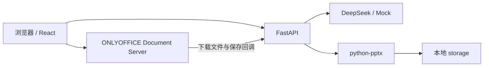

# HKTech300 PPT Generator

一个用于本地演示的 PPT AI 修改器。上传 PPTX 后，在 ONLYOFFICE 中查看和编辑，通过自然语言生成修改建议，再选择应用并下载。

前端使用 React + TypeScript + Vite，后端使用 FastAPI + python-pptx。AI 支持 DeepSeek，也提供无需密钥的 Mock 模式。

## Our Story

PPT Cursor began with a friend's frustration: hours spent manually updating PowerPoint presentations. Together, we built an AI editing prototype and submitted it to HKTech300. We are sharing the project to document that experiment and help others learn from it.

**[Read our full story and credits →](OUR_STORY.md)**

## 新旧版本 / Versions

- **原始上传版本 / Original upload**：[浏览原始源码](https://github.com/vanessajin888/HKtech-300-PPT-Generator/tree/55c57b1a63462d68d3373da004b48d3e30c04b3c)。原提交及上传记录完整保留。
- **整理后的版本 / Current edition**：当前 `main` 分支，包含 ONLYOFFICE 集成、精简源码、配置模板及回归测试。
- **[完整提交历史 / Full history](https://github.com/vanessajin888/HKtech-300-PPT-Generator/commits/main/)**：可以查看新旧版本之间的变化。

项目起源按作者回忆记录在 Our Story 中；GitHub 原始上传提交的时间戳为 2026-02-27。新版通过追加提交发布，保留原有时间戳和提交记录。历史快照仅供追溯，运行请使用当前版本及自己的配置。

## 功能

- 上传、在线查看及编辑 PPTX。
- 用自然语言提出文本修改要求，查看修改前后内容。
- 应用 AI 建议，包括修改文本、添加或删除文本框、插入幻灯片。
- 下载修改后的文稿，查看和回滚历史快照。

这是 HKTech300 的原型项目，适合本地体验和二次开发。复杂文稿的格式保真和保存一致性仍需完善。

## 架构



- `frontend/src/App.tsx`：上传、审核建议、同步编辑器和下载。
- `frontend/src/editor/`：ONLYOFFICE 集成。
- `frontend/src/aiPanel/`：AI 对话及修改对比。
- `backend/main.py`：HTTP API、文件管理、保存回调和历史版本。
- `backend/services_ai.py`：AI 意图与结构化修改转换。
- `backend/services/`：文本解析、建议生成和文稿写回。
- `backend/oo_plugins/patcher/`：编辑器定位和预览插件。
- `tests/`：使用临时生成文稿的离线回归测试。

## 本地启动

以下步骤以 macOS / Linux shell 为例。需要 Python 3.10+、Node.js 22 和 Docker Compose。已在 Apple Silicon Mac、Python 3.12、Node.js 22、Docker Desktop 上验证。

仓库中的 Compose 固定了已测试的 ARM64 镜像；其他 CPU 架构需要替换 `image` 和 `platform` 为对应的 ONLYOFFICE 镜像。原生 Linux 还需为容器配置 `host.docker.internal` 到宿主机的映射。

```sh
git clone https://github.com/vanessajin888/HKtech-300-PPT-Generator.git
cd HKtech-300-PPT-Generator
docker compose up -d
```

等待 http://localhost:8080/healthcheck 返回 `true`。首次下载和启动镜像可能需要几分钟。

### 后端（终端一）

```sh
cd backend
python3 -m venv .venv
source .venv/bin/activate
python -m pip install -r requirements.txt
cp .env.example .env
python -m uvicorn main:app --host 0.0.0.0 --port 8001
```

Windows PowerShell 的虚拟环境激活命令为 `.\.venv\Scripts\Activate.ps1`。健康检查地址：http://localhost:8001/health。

默认使用 Mock，不需要 API 密钥。启用 DeepSeek 时，修改 `backend/.env` 中的 `USE_DEEPSEEK=true`，填入自己的 `DEEPSEEK_API_KEY`，然后重启后端。启用后，文稿文本和修改指令会发送给配置的 AI 服务。

### 前端（终端二）

从项目根目录执行：

```sh
cd frontend
cp .env.example .env.local
npm ci
npm run dev
```

打开 http://localhost:5173，上传自己的测试 PPTX。Mock 可用“将 2024 更新为 2026”体验修改流程；它不具备真实模型的通用理解能力。

关闭前后端可在各自终端按 Ctrl+C，关闭编辑器服务执行 `docker compose stop`。运行文稿位于 `backend/storage/`，停止服务不会删除文稿。

### 服务连接

浏览器通过 8080 端口加载 ONLYOFFICE。Docker Desktop 容器通过 `host.docker.internal:8001` 下载文稿并回调后端。Vite 将 `/api` 转发到后端 8001。

当前配置用于可信本地环境：ONLYOFFICE 关闭 JWT，后端没有登录和权限控制，并监听所有网卡以允许容器回调。不要把端口映射到公网；联网部署需要补齐认证、JWT、网络访问限制和保存一致性处理。

## 验证

使用已安装后端依赖的 Python，在项目根目录运行：

```sh
python -m unittest discover -s tests -v
cd frontend
npm run typecheck
npm run build
```

离线测试覆盖上传、Mock AI、文本修改、文本框增删、插入幻灯片、中文文件名下载和路由清理。实际人工编辑后的 ONLYOFFICE 保存回调尚未完成端到端验收。

## 已知限制

- 预览会修改当前编辑器会话，拒绝建议未完整撤销预览。
- 插件对象索引和后端文本对象索引可能不一致。
- ONLYOFFICE 保存回调与 AI 写回可能竞争，影响最终保存结果。
- 当前前端生产 API 地址和回调地址面向本地运行，需要额外适配才能部署。
- 本次更新移除了旧手工编辑接口和无效预览接口，旧客户端需要同步更新。

请使用测试文稿体验，并保留原始文件。提交问题时附复现步骤和脱敏样例，不要上传密钥或私人文稿。

## 许可证

本项目代码采用 [MIT License](LICENSE)。ONLYOFFICE 及其他第三方组件遵循各自许可证，见 [THIRD_PARTY_NOTICES.md](THIRD_PARTY_NOTICES.md)。
